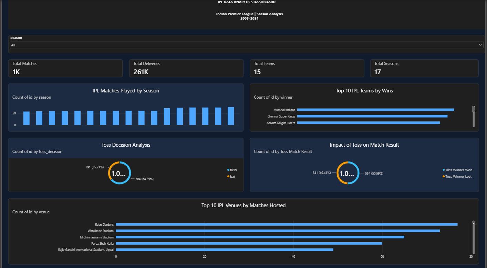
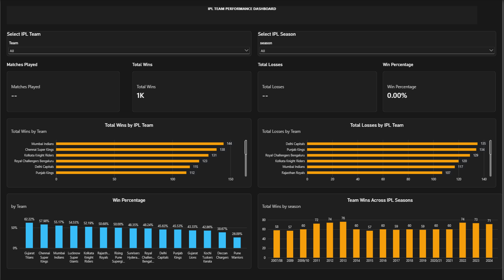

# IPL Data Analytics (2008–2024)

## Project Overview
An end-to-end IPL Data Analytics project analysing match results, team performance, player statistics, toss decisions and season-wise trends.

## Tools & Technologies
- Python (Pandas, NumPy, Matplotlib)
- SQL Server
- Power BI
- Excel / Google Sheets

## Project Workflow
1. Data cleaning and preprocessing using Python.
2. Exploratory Data Analysis (EDA).
3. SQL-based analysis using Microsoft SQL Server.
4. Interactive dashboard development using Power BI.
5. Excel analysis using summary tables, pivot tables and charts.

## Dataset
- 1,095 IPL matches
- 17 seasons (2008–2024)
- 15 teams
- Ball-by-ball delivery data

The cleaned datasets are used for the analysis. The large cleaned deliveries file is stored separately in Google Drive.

## Key Insights
- Mumbai Indians recorded the most wins (144).
- Virat Kohli topped the batting analysis with 8,014 runs.
- Yuzvendra Chahal topped the bowler-credited wickets analysis with 205 wickets.
- Chris Gayle recorded the highest individual score of 175

## Power BI Dashboard Previews

### IPL Overview

### Team Performance

### Player Performance
.png)
